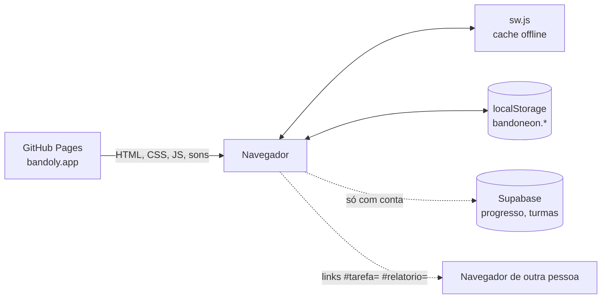

# Arquitetura do BanDoly

Um mapa curto para quem vai mexer no código: o que existe, onde fica e o que nunca pode quebrar.
O visual está em [DESIGN.md](DESIGN.md), o produto em [PRODUCT.md](PRODUCT.md) e o porquê das decisões grandes
em [docs/decisoes/](docs/decisoes/). Este arquivo é conferido pelos testes (`ferramentas/verificar_arquitetura.py`):
se a ordem dos scripts ou as áreas mudarem no código, atualize aqui.

## Visão de cima

O BanDoly é um site estático que vira app (PWA). Não tem build nem servidor próprio: o navegador baixa
`index.html`, `css/` e `js/` do GitHub Pages, e o service worker guarda tudo para funcionar sem internet.
O progresso mora no aparelho (`localStorage`). A conta no Supabase é opcional e só guarda uma cópia.

Professor e aluno trocam tarefas e relatórios **dentro do próprio link** (base64url), sem servidor. Só as
turmas usam o banco.

## Mapa do código

- **Entrada:** `index.html` tem todas as abas (`<section id="v-nome">`) e carrega os scripts clássicos com
  `defer`. Eles dividem o mesmo escopo global e rodam nesta ordem:

<!--scripts-->
`moldura, goatcounter, base, i18n-textos, i18n, licoes-traducao, audio, teclado, movimento, navegacao, menus, fole, desafios, ritmo, atalhos, controles, melodias, musicxml, escalas, microfone, acordes, academia, partituras, rotina, licoes, ajustes, ouvido, eco, qualnota, cascata, trilha, inicio, professor, relatorio, teoria, contato, conta, turmas, init`
<!--/scripts-->

  Código que roda no carregamento só usa o que veio antes; dentro de funções, tudo já existe. `init.js` é o último.
- **Sob demanda:** a Teoria (`teoria-kit`, `teoria-textos`, `teoria-frases`, `teoria-topicos`, `css/teoria.css`)
  é baixada quando a aba abre (`carregarTeoria`). Os sons gravados (`sons/bandoneon.js`) vêm no primeiro gesto
  (`carregarSons`). A biblioteca do Supabase (`js/vendor/supabase.js`) só para quem usa a conta.
- **Áreas e abas** (`AREAS` em `navegacao.js`; `go(aba)` troca, `ganchosAba` avisa quem precisa saber):

<!--areas-->
- inicio: inicio
- aprender: estudo, academia, licoes, teoria
- tocar: teclado, melodias, acordes, microfone
- treinar: desafios, qualnota, eco, ritmo
- professores: professor, relatorios, turmas
- perfil: conta, ajustes
<!--/areas-->

- **Núcleo:**
  - `base.js`: o `state` e o `store` (localStorage com prefixo `bandoneon.`).
  - `teclado.js`: `kb()`, o teclado do bandoneon, usado por todas as telas de prática.
  - `audio.js`: as vozes, o `foleBus` e a pressão do fole.
  - `melodias.js`: o formato de texto das músicas e o fluxo `parseMelody` → `buildTimeline` → `fingerMelody`.
  - `fole.js`, `controles.js`: fole, teclado do computador e MIDI.
- **Telas:** um arquivo por área (`academia`, `eco`, `licoes`, `teoria`, `professor`, `turmas`…), com o
  comentário do topo explicando o que a tela faz.
- **Fora do app:**
  - `doly-costa/`, `perguntas-frequentes/`, `privacidade/`, `termos/`, `professores/`: páginas estáticas.
  - `es/`, `en/`, `licoes/`, `teoria/`, `notas-do-bandoneon/`: **geradas** por `ferramentas/gerar_*.py`.
  - `supabase/*.sql`: o banco (tabelas, regras de acesso e funções).
  - `tests/`: `testes.js` roda dentro do `index.html` num Edge invisível (`rodar_testes.py`).

## Invariantes

Regras que valem para qualquer mudança. Quebrar uma delas é um defeito, mesmo que os testes passem.

1. **O app inteiro funciona sem conta e sem internet** (depois da primeira visita). A conta só copia.
2. **Sem build.** O que está no repositório é o que vai para o site. Nada de bundler, nada de dependência de npm em produção.
3. **Todo arquivo servido está em `ARQUIVOS` no `sw.js`**, e qualquer mudança sobe o `CACHE` (`bandoly-vNN`).
4. **`es/`, `en/` e as páginas de lições e teoria são geradas:** nunca à mão.
5. **O app é escrito em português;** a tradução vem de `i18n-textos.js` (e `t()` no código), com 0 textos sem tradução.
6. **Só a chave publicável do Supabase vai para o site.** A chave secreta nunca entra no site nem no repositório.
7. **Toda tabela tem RLS:** cada pessoa só lê e grava o que é dela; o professor vê da turma só o resumo da tarefa.
8. **Contas só para maiores de 18 anos** (LGPD). Sem conta, nenhum dado sai do aparelho além da contagem anônima de visitas.
9. **Nenhum script de outro servidor:** a CSP só permite scripts do bandoly.app (GoatCounter e Supabase são cópias locais).
10. **O conteúdo musical tem fonte:** nada de dedilhado, técnica ou melodia inventada; só obras em domínio público.

## Fronteiras de dados

| Onde | O quê | Quem vê |
|------|-------|---------|
| Aparelho (`localStorage`) | tudo: progresso, músicas, ajustes, relatórios recebidos | só o aparelho |
| Supabase `progresso` | uma cópia do que o app guarda, menos o que é do aparelho (`NAO_SINCRONIZA`) | só a própria pessoa |
| Supabase `turmas`, `turma_alunos` | nome escolhido pelo aluno, dias de prática, resultado da tarefa | o professor da turma |
| Links `#tarefa=`, `#relatorio=` | o que a pessoa decidiu mandar | quem recebe o link |
| GoatCounter | contagem de visitas, sem cookie | o dono |

O que vem de fora (links, arquivos importados, linhas do banco) é sempre limpo antes de usar (`limparRel` e afins).

## O que atravessa tudo

- **Tradução:** MutationObserver em `i18n.js`; texto rico fica inteiro por idioma (`translate="no"`).
- **Movimento:** `movimento.js`; tudo respeita `movReduzido()` e a classe `sem-mov`.
- **Desempenho:** nada de ler medidas de coisa escondida no carregamento; teclados de abas escondidas ficam pendentes.
- **Testes:** `python tests/rodar_testes.py` confere os testes, o `sw.js`, as páginas geradas, o grid de 8 pontos e este arquivo.
- **Publicar:** direto na `main`; o GitHub Pages publica em 1 a 2 minutos.

## Quando registrar uma decisão

Mudança que troca uma invariante, acrescenta um serviço de fora, muda onde o dado mora ou cria uma dependência
nova vira um registro em `docs/decisoes/` (contexto, decisão, alternativas, consequências) antes de ser feita.
