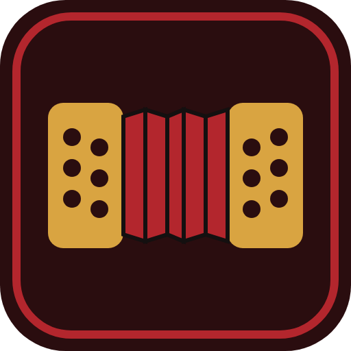

<p align="center"></p>

# BanDoly - Aprenda Bandoneon

O **BanDoly** é um app gratuito e interativo para aprender **bandoneon**, o instrumento do tango. Você toca num teclado virtual com o som de um bandoneon de verdade, segue escalas e melodias guiadas, treina acordes e ritmos e, se tiver o instrumento, pode tocar nele enquanto o app escuta pelo microfone.

Funciona no navegador, no computador ou no celular, em **português, espanhol e inglês**: [bandoly.app](https://bandoly.app), [bandoly.app/es](https://bandoly.app/es/) e [bandoly.app/en](https://bandoly.app/en/) (ou pelas bandeiras no topo). Não precisa instalar nada nem criar conta.

O nome é uma homenagem a **Doly Carlos da Costa** (Caçapava do Sul), bandoneonista gaúcho que, aos 97 anos, ainda toca. Ele tocou nas orquestras de tango das rádios de Porto Alegre, fundou o grupo Os Posteiros e recebeu a Medalha Simões Lopes Neto. A história dele está em [bandoly.app/doly-costa](https://bandoly.app/doly-costa/) (também em espanhol e inglês).

A teoria musical também tem páginas próprias em [bandoly.app/teoria](https://bandoly.app/teoria/).

Dúvidas sobre o instrumento e sobre como começar estão em [bandoly.app/perguntas-frequentes](https://bandoly.app/perguntas-frequentes/), uma página própria (também em espanhol e inglês), com busca e categorias.

---

## Sumário

- [Como abrir o app](#como-abrir-o-app)
- [O bandoneon em 1 minuto](#o-bandoneon-em-1-minuto)
- [Por onde começar](#por-onde-começar)
- [O que tem em cada aba](#o-que-tem-em-cada-aba)
- [Atalhos do teclado](#atalhos-do-teclado)
- [Tocando com o seu bandoneon (microfone)](#tocando-com-o-seu-bandoneon-microfone)
- [Escrevendo as suas melodias](#escrevendo-as-suas-melodias)
- [Importando partituras do MuseScore](#importando-partituras-do-musescore)
- [Seus dados](#seus-dados)
- [Para quem quer mexer no código](#para-quem-quer-mexer-no-código)
- [Créditos](#créditos)

---

## Como abrir o app

**Online:** o app fica em **[bandoly.app](https://bandoly.app)**. Por esse link dá para **instalar no celular** (botão *Instalar app* em Ajustes) e usar **sem internet**.

**No seu computador:** baixe o repositório (botão verde *Code → Download ZIP*), descompacte e abra o arquivo `index.html` no Chrome, Edge ou Firefox.

> 💡 Use fones de ouvido. Na primeira vez que você tocar algo, o app carrega os sons, o que leva um ou dois segundos.

---

## O bandoneon em 1 minuto

Três ideias explicam quase tudo o que o app ensina:

1. **É bisonoro.** Cada botão toca **uma nota abrindo** o fole e **outra nota fechando**. Por isso você aprende quatro "mapas": mão direita abrindo, mão direita fechando, mão esquerda abrindo e mão esquerda fechando.
2. **O fole é um só.** As duas mãos sempre tocam na **mesma direção**, e o fole tem tamanho limitado. Planejar onde inverter o fole faz parte de tocar bem.
3. **Este app usa o sistema Rheinische 142**, o padrão do tango: 71 botões (38 na mão direita e 33 na esquerda) × 2 direções = 142 vozes.

```
   abrindo  ⟵ fole ⟶            fechando  ⟶ fole ⟵
   o botão X toca Sol4            o mesmo botão X toca Lá4
```

---

## Por onde começar

Na primeira visita o app faz **três perguntas** (se você já toca algum instrumento, se tem um bandoneon e o que quer tocar) e monta o **Seu caminho** na aba **Aprender → Meu estudo**: uma sequência de etapas que se marcam sozinhas conforme você pratica, com um botão para a próxima. Dá para refazer as perguntas em **Perfil → Conquistas**.

A mesma aba mostra o **Continue de onde parou**, os seus recordes e a **Rotina de hoje**: cinco tarefas curtas que se marcam sozinhas conforme você pratica, mais quantos dias seguidos você estudou.

Se preferir seguir sozinho, esta é uma boa ordem:

| Passo | Onde | O que fazer |
|---|---|---|
| 1 | **Lições** | Leia as lições 1 a 4 e responda aos quizzes (uns 15 minutos). |
| 2 | **Teclado** | Toque à vontade e aperte <kbd>Espaço</kbd> para ver as notas mudarem ao inverter o fole. |
| 3 | **Melodias → Escalas guiadas** | Faça *Dó maior* no modo **Espera**. O app explica cada passo. |
| 4 | **Desafios** | Faça uma rodada de *Encontre a nota* para começar a decorar os botões. |
| 5 | **Rotina de hoje** | Volte todo dia. Um pouco por dia rende mais que muito de uma vez. |

---

## O que tem em cada aba

O menu tem o **Início** e quatro áreas, cada uma com as suas abas no topo da tela:

| Área | Abas |
|---|---|
| **Aprender** | Meu estudo, Academia, Lições (com duas trilhas: o bandoneon e a teoria musical) |
| **Tocar** | Teclado, Melodias, Acordes, Bandoneon real |
| **Treinar** | Desafios, Ritmo |
| **Perfil** | Conquistas, Para professores, Ajustes |

| Aba | Para que serve |
|---|---|
| **Início** | A apresentação do app, com um botão que leva direto à próxima etapa do seu caminho, os atalhos e as perguntas mais comuns. |
| **Meu estudo** | O seu caminho de estudo, o "continue de onde parou", os recordes e a rotina do dia, com a sequência de dias praticados. |
| **Lições** | 11 lições curtas, cada uma com quiz (e, em várias delas, uma tarefa "Experimente agora" para tocar no teclado no meio da explicação): história, partes do instrumento, sistema bisonoro, fole e articulação, leitura nas duas claves, ritmos de tango, acordes, duas mãos e como ler uma partitura de tango. |
| **Academia** | Primeiro você escolhe o nível e o exercício (a escolha se recolhe numa linha enquanto você toca), depois o modo e a velocidade numa barra logo acima do teclado. O teclado mostra só a mão que o exercício usa; com as duas mãos, elas ficam lado a lado com o fole no meio. Exercícios em **6 níveis** (botões, dedos, independência dos dedos, fole, duas mãos e músicas), cada um nos modos **Aprender** (mostra o próximo botão, o dedo e o fole e espera a nota certa), **Praticar** (no seu ritmo, apontando os erros) e **Desafio** (no tempo, com metrônomo; a velocidade sobe e os auxílios somem conforme a sua precisão). Um **instrutor** ao lado do teclado mostra a nota, a mão, o fole e a posição das mãos, e no fim vem um relatório com o que errou e o que treinar. No nível 7, **Minhas partituras**, você importa uma partitura (MusicXML ou MIDI) e o app transcreve cada nota para um botão, com a mão, o fole, a duração e as pausas; o botão **Transcrição** mostra a tabela nota a nota. |
| **Lições → Teoria musical** | Sete tópicos curtos de teoria musical com som: notas e oitavas, a pauta e as claves (a pauta toca a nota clicada), sustenido e bemol, figuras e pausas (cada figura toca no tempo), compasso, escalas e acordes. Cada tópico tem um teste rápido e um atalho para praticar. |
| **Teclado** | Os 71 botões nas posições reais, com som de bandoneon. Um fole simulado mostra quando ele chega ao fim, e a **válvula de ar** reposiciona o fole sem som. No celular dá para ver **uma mão por vez**, com botões maiores. |
| **Bandoneon real** | Para quem tem o instrumento: liga o microfone, mostra a nota ouvida num **afinador** (de -50 a +50 cents) e acende no teclado os botões que dão essa nota. O botão **Calibrar o silêncio** mede o barulho do ambiente para o app ignorar o que for mais baixo. |
| **Desafios** | *Encontre a nota*: o app pede uma nota e você acha o botão. O sorteio **inteligente** repete mais os botões que você erra, e o **mapa de erros** pinta o teclado do verde ao vermelho. Há também a *Leitura na pauta*, a **Pauta no bandoneon** (a nota aparece na pauta e você toca o botão: a ponte entre ler e tocar) e o **Treino de ouvido**: o app toca uma nota e você encontra o botão só pelo som; ao errar, ele diz se a nota é mais aguda ou mais grave e toca de novo. |
| **Melodias** | Toque melodias e escalas em três modos: **Ouvir** (o app toca e mostra), **Espera** (avança quando você acerta) e **No tempo** (com metrônomo e pontuação). Funciona com uma ou duas mãos e mostra a **partitura com cursor** e a **direção sugerida do fole** em cada nota. Para quem ainda não lê partitura, a opção **Notas caindo** mostra as notas descendo até uma linha dourada no tempo da música, coloridas pelo fole. |
| **Acordes** | Mostra onde ficam os botões de 72 acordes (maior, m, 7, m7, m6 e °7 em todas as tônicas), abrindo e fechando, nas duas mãos. Tem treino com conferência. |
| **Ritmo** | Os acompanhamentos do tango (marcato, síncopa, 3-3-2 e arrastre) e o modo **toque junto**, que mede se você está adiantado ou atrasado. |
| **Conquistas** | 13 insígnias ganhas praticando (a última é a **Medalha Doly Costa**, por completar o caminho). Cada uma vira uma imagem para **compartilhar** no WhatsApp ou no Instagram. |
| **Ajustes** | Som (gravação real ou sintetizado), afinação (440, 442 ou 443 Hz), volume, nomes das notas (Dó Ré Mi ou C D E), **animações** (normais ou reduzidas), **vibração** no celular e backup. |
| 🇧🇷 / Uruguai-Argentina / 🇬🇧 | Idioma do app: português, espanhol ou inglês. Na primeira visita vale o idioma do navegador. |

**Cores que aparecem no app:** 🔵 azul = *abrindo* · 🟠 laranja = *fechando* · 🟡 contorno dourado = *o próximo botão a tocar*.

**Movimento:** o app usa animações curtas para mostrar o que mudou (troca de abas, acerto, erro, conquista nova). Elas somem se o sistema pedir "reduzir movimento" ou se você escolher **Animações: Reduzidas** em Ajustes; a informação continua a mesma. No celular, acerto e erro também **vibram** (dá para desligar).

---

### Sobre o dedilhado na Academia

O app sabe conferir a **nota**, o **botão**, a **mão**, a **direção do fole** (na tela) e o **ritmo**. Ele **não consegue saber qual dedo você usou**: nem o toque na tela nem o microfone dizem isso. Por isso o dedo aparece sempre como *sugerido*, e o relatório nunca diz que conferiu o seu dedo. O código já tem um ponto de ligação para um validador futuro, por exemplo uma câmera que reconheça os dedos (`registrarValidadorDeDedos` em `js/academia.js`).

O dedo de cada nota vem da partitura do exercício (`@dedo` no formato de texto), não de uma regra fixa por botão, porque a digitação muda conforme a frase. Como não encontramos uma fonte com a digitação nota a nota dos exercícios, o app **não indica dedo** nos exercícios prontos. No lugar, o instrutor dá **dicas de posição tiradas do mapa**: se o próximo botão é vizinho, se fica longe, se o fole vai inverter, se a próxima nota é na outra mão ou se as próximas notas ficam na mesma região. Quando uma partitura importada traz o dedo, ele aparece como sugestão. Os polegares não tocam botões: o direito cuida da válvula de ar e o esquerdo fica apoiado na caixa.

---

## Atalhos do teclado

| Tecla | Onde | O que faz |
|---|---|---|
| <kbd>Espaço</kbd> | Teclado, Melodias, Academia | Inverte a direção do fole |
| <kbd>Espaço</kbd> | Ritmo | Marca a batida no modo *toque junto* |
| <kbd>A</kbd> (segurar) | Teclado | Válvula de ar: **abre** o fole sem som |
| <kbd>F</kbd> (segurar) | Teclado | Válvula de ar: **fecha** o fole sem som |

No celular ou tablet, toque nos botões com os dedos. Vários dedos ao mesmo tempo formam um acorde.

### Teclado do computador, controlador MIDI e pressão do fole

No computador, **as teclas do computador já tocam os botões** (dá para desligar em **Teclado → Tocar com → Teclado do computador**): as quatro fileiras do teclado ficam sobre as fileiras de botões de cada mão (à esquerda do teclado, a mão esquerda). **Mapa e controles** mostra qual nota cada tecla toca e permite trocar qualquer tecla: toque **Editar o mapa**, depois um botão na tela e a tecla desejada. Na aba Teclado, <kbd>Espaço</kbd> troca o fole, <kbd>←</kbd> e <kbd>→</kbd> seguram a válvula de ar (com o teclado desligado, <kbd>A</kbd> e <kbd>F</kbd> também) e <kbd>↑</kbd> e <kbd>↓</kbd> mudam a pressão do fole.

Um **controlador MIDI** (teclado MIDI ou bandoneon digital, no Chrome ou no Edge) também toca: cada nota acende o botão que dá essa nota na direção atual do fole. Na mesma janela dá para **ensinar** um botão específico para uma nota e **aprender** dois controles do aparelho: um para a pressão do fole (pedal de expressão, roda ou botão giratório) e outro para a direção do fole (por exemplo, o pedal de sustentação).

A **pressão do fole** muda o volume em tempo real e a velocidade com que o fole simulado anda, como no instrumento.

---

## Para professores

Em **Perfil → Para professores** você monta uma **tarefa**: escolhe o exercício da Academia (inclusive uma partitura sua), o modo, a velocidade e escreve uma mensagem. O app gera um **link**; ao abrir, o aluno encontra o exercício pronto, com a mensagem. No fim de cada tentativa, o botão **Enviar ao professor** manda o relatório por WhatsApp, e-mail ou cópia. Para registrar a digitação, use **Editar digitação** na Academia: escolha o dedo de cada nota tocando na faixa. Ela aparece para o aluno como "digitação do professor" e pode ir junto no link. Tudo viaja dentro do próprio link, sem servidor nem cadastro.

## Sugestões e erros

O botão **Sugestões** (no menu) e **Ajustes → Fale com a gente** abrem um formulário que manda a mensagem como uma *issue* no GitHub do projeto, já preenchida (pede uma conta gratuita do GitHub), ou copia o texto para enviar por outro meio.

## Tocando com o seu bandoneon (microfone)

Comece pela aba **Bandoneon real** (área Tocar): ligue o microfone, calibre o silêncio e toque algumas notas para ver se o app está ouvindo bem. Depois, na aba **Melodias**, marque **Usar microfone** (ou **Microfone** na Academia) e permita o acesso quando o navegador pedir. Depois escolha o modo **Espera** ou **No tempo** e toque no seu instrumento.

- O app mostra a nota que está ouvindo e quanto ela está desafinada, em *cents*. Também serve como afinador.
- O microfone não sabe para que lado o fole está andando, então o app confere só a nota.
- A nota uma oitava acima ou abaixo também vale, porque o bandoneon soa duas palhetas em oitava.
- Para funcionar melhor, pratique num lugar silencioso, com o celular ou o computador perto do instrumento.

---

## Escrevendo as suas melodias

Em **Melodias → + Nova**, escreva a música num formato de texto simples:

```
título: Minha primeira melodia
mão: direita
bpm: 80
Dó4:4 Ré4:4 Mi4:4 p:4 | Mi4:4 Ré4:4 Dó4:2
```

Cada nota é **nome + oitava : duração**. O `Dó4` é o dó central do piano.

| Você escreve | Significa |
|---|---|
| `Sol4:4` | semínima (1 tempo) |
| `Sol4:2` / `Sol4:1` | mínima (2 tempos) / semibreve (4 tempos) |
| `Sol4:8` / `Sol4:16` | colcheia / semicolcheia |
| `Sol4:4.` | com ponto (vale 1,5 vez) |
| `Sol4:8t` | colcheia de tercina |
| `Sol4:2~ \| Sol4:4` | ligadura: as duas notas viram uma só |
| `p:4` | pausa de 1 tempo |
| `Fá#4`, `Sib3`, `G4` | sustenido, bemol, ou nomes em inglês |
| `Sol4:4/f`, `Sol4:4/a` | força a direção do fole (fechando ou abrindo) |
| `Sol4:4@3`, `Sol4:4@3,2` | dedo recomendado (3) e, depois da vírgula, outros dedos aceitos |

**Duas mãos:** comece as linhas com `direita:` e `esquerda:`. Cada mão conta o próprio tempo, e o app junta as duas usando um fole só.

```
título: Exemplo a duas mãos
bpm: 80
direita:  Mi4 Mi4 Fá4 Sol4 | Sol4 Fá4 Mi4 Ré4
esquerda: Dó3:2 Dó3:2      | Sol2:2 Sol2:2
```

O app sugere sozinho a direção do fole: ele troca o mínimo possível, nunca deixa o fole passar do limite e não inverte enquanto uma nota está soando.

---

## Importando partituras do MuseScore

1. No [MuseScore](https://musescore.org) (gratuito), abra a partitura e use **Arquivo → Exportar → MusicXML**.
2. No app, vá em **Melodias → ⇪ Importar MusicXML** e escolha o arquivo (`.mxl` ou `.musicxml`).
3. Escolha a pauta. Com **Duas mãos**, a pauta de cima vai para a mão direita e a de baixo para a esquerda.
4. Revise o texto gerado e clique em **Salvar e usar**.

Em acordes, o app fica com a nota mais aguda (melodia) ou a mais grave (baixo). Se a música não couber na extensão do bandoneon, ele pode mudá-la de oitava.

> Use partituras em domínio público ou que você tenha o direito de usar.

---

## Seus dados

O seu progresso, as melodias que você criou e eventuais ajustes no mapa de botões ficam **só no seu navegador**. Nada é enviado para a internet.

Em **⚙ Ajustes → Seus dados**, use **Exportar backup** para guardar um arquivo com tudo, e **Importar backup** para recuperar ou levar os dados a outro aparelho.

---

## Para quem quer mexer no código

O app é feito só com HTML, CSS e JavaScript, **sem build e sem dependências**. Basta editar e recarregar a página.

### Estrutura

```
index.html            a página com todas as abas
css/app.css           o visual
js/                   um arquivo por parte do app, carregados em ordem pelo index.html
  base.js             estado global, mapa de botões, nomes de notas, localStorage
  audio.js            motor de som (amostras e sintetizado)
  teclado.js          componente que desenha um teclado e trata os toques
  movimento.js        animações (cascata, anéis, confete), "reduzir movimento" e vibração
  navegacao.js        áreas e abas (go), barra de abas e progresso da tela Início
  fole.js             aba Teclado: simulação do fole e válvula
  desafios.js         Encontre a nota (com revisão inteligente) e Leitura na pauta
  ritmo.js            padrões de tango e "toque junto"
  melodias.js         player de melodias, formato de texto, fole automático e partitura
  musicxml.js         importação de partituras
  escalas.js          escalas guiadas
  microfone.js        detecção de altura (algoritmo YIN) e a aba Bandoneon real (afinador)
  acordes.js          dicionário e treino de acordes
  rotina.js           rotina diária e sequência de dias
  licoes.js           conteúdo das lições
  ajustes.js          aba Ajustes e backup
  ouvido.js           Desafios → Treino de ouvido
  cascata.js          Melodias → Notas caindo
  trilha.js           perguntas da primeira visita, caminho de estudo, conquistas e cartão para compartilhar
  i18n.js             tradução da interface (português → espanhol / inglês)
  i18n-textos.js      dicionário de traduções
  licoes-traducao.js  lições em espanhol e inglês
  init.js             inicialização (carregado por último)
sons/bandoneon.js     amostras de som (geradas a partir do SoundFont)
ferramentas/          sf2_para_js.py (SoundFont → sons) e extrair_textos.py (confere traduções)
icones/, manifest.webmanifest, sw.js    app instalável e funcionamento offline
tests/                testes automáticos
```

### Como as peças se encaixam

- **Notas são números MIDI** (60 = Dó4) e a direção do fole é `'open'` ou `'close'`. Cada botão do mapa é `{id, x, y, open, close}`.
- **Teclados** são criados com `kb(elemento, mão, opções)`. A aba informa a direção do fole e recebe os toques por `onPress`.
- **Melodias** passam por três funções: `parseMelody` (lê o texto) → `buildTimeline` (agrupa as notas que começam juntas) → `fingerMelody` (escolhe a direção do fole e os botões). A direção do fole é escolhida por programação dinâmica: o menor número de trocas que respeita o tamanho do fole.
- **Abas e áreas**: cada aba é uma `<section id="v-nome">` e tem um botão em `#subnav` com `data-area`. A lista `AREAS` em `js/navegacao.js` diz que abas cada área tem. Para fazer algo ao abrir ou sair de uma aba, use `ganchosAba.push((nova, anterior) => …)`.
- **Caminho e conquistas** não guardam "feito" à mão: cada etapa (`ETAPAS`) e cada insígnia (`INSIGNIAS`) em `js/trilha.js` tem uma função `feito()` que olha o progresso. Só a data em que a insígnia foi ganha fica salva.
- **Acerto e erro** no teclado passam por `api.mark(id, 'ok' | 'bad')`, que também anima o botão e vibra o celular. Para comemorar um bom resultado, chame `comemorar()`.
- **Desempenho**: os scripts têm `defer`; cada teclado só é desenhado quando a aba dele aparece (`construirPendentes`, em `js/teclado.js`); o som gravado é baixado no primeiro toque. Evite ler medidas do layout (`offsetWidth`, `clientWidth`) de coisas escondidas durante o carregamento: isso obriga o navegador a montar a página inteira antes da hora.
- **Páginas para o Google**: `ferramentas/gerar_licoes.py` (lições) e `ferramentas/gerar_teoria.py` (teoria) geram as páginas a partir do conteúdo do app; os testes avisam se estiverem desatualizadas.
- Os arquivos JS **compartilham o escopo global** e são carregados em ordem. Código que roda no carregamento só pode usar o que já foi definido nos arquivos anteriores.

### Traduções

O código e o `index.html` são escritos **em português**. O `js/i18n.js` traduz na tela tudo o que aparece, inclusive o que o código gera, usando o dicionário `js/i18n-textos.js`:

```js
'Rodada {}/10 · Acertos: {}': ['Ronda {}/10 · Aciertos: {}', 'Round {}/10 · Correct: {}'],
//  português (chave)           espanhol                       inglês
```

- `{}` marca um valor que muda (número, nota…), na mesma ordem.
- Mensagens em `alert`, `confirm` e `prompt` não passam pela página: no código, use `t('texto', valores…)`.
- As lições têm tradução inteira em `js/licoes-traducao.js`.

Depois de criar ou mudar um texto, rode o script abaixo. Ele lista o que ainda não tem tradução:

```
python ferramentas/extrair_textos.py
```

**Páginas em espanhol e inglês.** Cada idioma tem o seu endereço (`/`, `/es/` e `/en/`), com os textos já traduzidos no HTML, para o Google mostrar cada página no seu idioma. O `es/index.html` e o `en/index.html` são **gerados** a partir do `index.html` e do dicionário. Não edite esses dois arquivos: depois de mudar o `index.html` ou o dicionário, rode

```
python ferramentas/gerar_idiomas.py
```

Os testes avisam se as páginas estiverem desatualizadas. As bandeiras levam para a página do idioma e guardam a escolha; quem abre `bandoly.app` depois de escolher espanhol ou inglês vai direto para a sua página.

**Páginas das lições.** Cada lição também tem uma página própria, para aparecer no Google: [bandoly.app/licoes](https://bandoly.app/licoes/) (e `/es/licoes/`, `/en/licoes/`), com o texto, o quiz e um botão que abre a mesma lição no app (o endereço `#licao-3` abre a lição 3; `#teclado`, `#ritmo` etc. abrem a aba). As páginas são **geradas** a partir de `js/licoes.js` e `js/licoes-traducao.js`, e o mesmo script atualiza a parte das lições no `sitemap.xml`. Depois de mudar uma lição, rode

```
python ferramentas/gerar_licoes.py
```

### Testes

```
python tests/rodar_testes.py
```

O script abre o app no Edge ou Chrome em modo invisível e roda `tests/testes.js`: mapa, som, fole, melodias, duas mãos, MusicXML, escalas, acordes, microfone, rotina e lições. Ele também percorre o app em espanhol e em inglês procurando textos que ficaram em português. Ele também confere se o `sw.js` guarda todos os arquivos usados pelo `index.html`.

### Cuidados ao mudar

- **Arquivo novo** em `index.html`? Inclua-o também em `ARQUIVOS` no `sw.js`, para funcionar offline. Os testes avisam se faltar.
- **Mudou o `index.html` ou o dicionário?** Rode `python ferramentas/gerar_idiomas.py` para atualizar as páginas `es/` e `en/`.
- **Mudou uma lição?** Rode `python ferramentas/gerar_licoes.py` para atualizar as páginas das lições.
- **Lição nova?** Acrescente **no fim** da lista em `licoes.js`. O progresso é salvo pela posição da lição.
- **Outro SoundFont?**
  ```
  python ferramentas/sf2_para_js.py caminho/do/arquivo.sf2 sons/bandoneon.js
  ```
  Se a afinação das amostras for diferente, ajuste `SF_REF_A` em `audio.js`.

---

## Créditos

- **Fonte:** *Nunito*, de Vernon Adams e Jacques Le Bailly (SIL Open Font License), guardada em `fontes/` para funcionar sem internet.
- **Fotos e documentos de Doly Costa:** acervo particular.
- **Som:** SoundFont *Bandoneon V2.5*, de **Jörg Bleymehl** (2016), gravado num bandoneon ELA de 1930, com edição GM de Mike77154. O autor permite o uso livre, inclusive em projetos de software. As gravações estão afinadas em Lá ≈ 443 Hz.
- **Mapa de botões (Rheinische 142):** transcrito dos diagramas de **Omar Caccia** (mão direita abrindo, mão esquerda fechando) e **Matías Gobbo** (mão direita fechando, mão esquerda abrindo). Se o seu instrumento tiver alguma diferença, ajuste em *Teclado → Mapa de botões → Editar layout*.

## Licença

© 2026 Lucca Mello. **Todos os direitos reservados.** O app pode ser usado em [bandoly.app](https://bandoly.app), mas o código e o conteúdo não podem ser copiados nem reutilizados sem autorização. As partes de terceiros (fonte Nunito, som do bandoneon, fotos de Doly Costa) mantêm as próprias licenças. Detalhes em [LICENSE](LICENSE).
